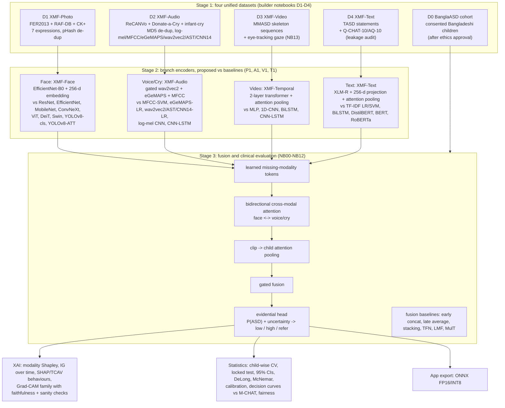

# XMF: BanglaASD-XMF

**Early Autism Detection using Voice Recognition, Face Verification, and Cry in Bangladesh**
(UGC research proposal, Dept. of CSE, Comilla University), carried out as in the *Q1 Master Plan*.
The goal is an explainable, missing-modality-robust fusion of facial-expression video, voice, cry and
questionnaire/text, used for autism **screening** (decision support, never a diagnosis), with a clinician-facing app.

## 1. Architecture

## 2. Notebook order (runs automatically, one at a time)

| stage | notebook | what it does |
|---|---|---|
| 1 | D1 Photo / D2 Audio / D3 Video / D4 Text | build the four unified datasets (manifest + datasheet each) |
| 2 | P1 / A1 / V1 / T1 | **proposed model vs baselines** in each sector, same splits and budget for all |
| 2 | NB13 | gaze: ASD vs TD on real eye-tracking data, child-wise CV, shortcut baselines |
| 3 | NB00 to NB12 | cohort pipeline: audit and splits, face and audio pipelines, frame and video baselines, **XMF vs 6 fusion baselines**, ablations and shortcut tests, XAI, statistics, app export |

**Until the consented cohort exists, Stage 3 runs on a clearly labelled synthetic DEV cohort.** That only proves
the pipeline works, and none of its numbers are results.

## 3. Protocol for every comparison
* The same splits, image size, epoch budget and seeds for all models. Subject-, speaker- or child-wise splits wherever IDs exist.
* Early stopping on validation; the test data is used once. Label smoothing, weight decay, augmentation and mixup.
* Over/underfitting is reported for every model as train vs validation accuracy, the gap, and learning curves.
* 95% bootstrap CIs, McNemar or DeLong against the proposed model, with Holm correction.
* The scraped "Autistic Children Facial Data Set" and its mirrors are **not used** (38+ retractions).

## 4. How it runs
`.github/workflows/queue.yml` wakes every 20 minutes. It starts the next Kaggle notebook when the previous one has
finished, and commits each finished notebook's tables, figures and logs to `outputs/<notebook>/`.
It needs one repository secret, `KAGGLE_API_TOKEN` (Settings → Secrets and variables → Actions).

## 5. Layout
`asd_lib/` shared code · `notebooks/src/` notebook sources · `kaggle_build/` built notebooks ·
`tools/` queue and sync tools · `outputs/` results, filled in automatically.
